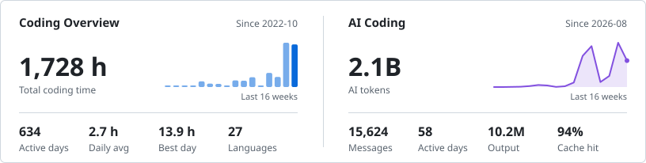
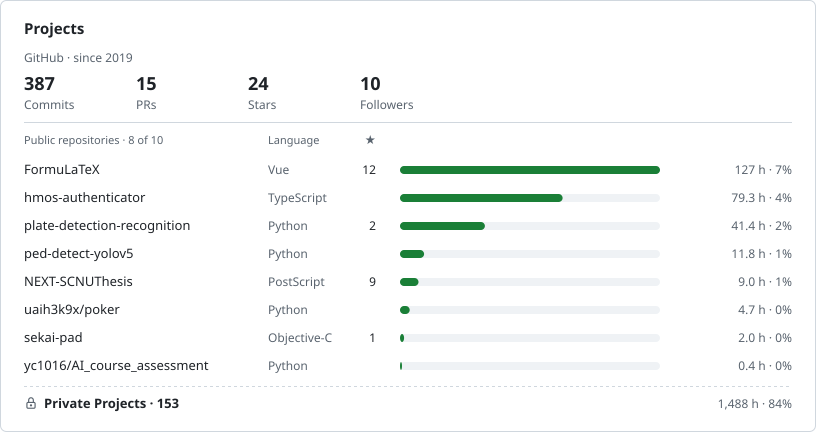
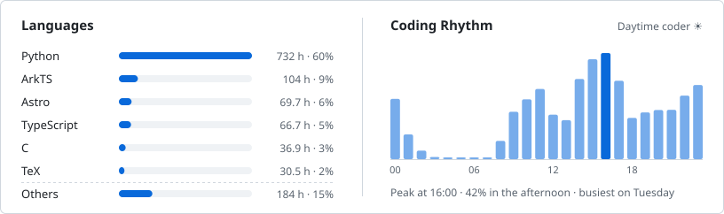

# Hi, I'm LKY 

<b>[ Bilibili](https://space.bilibili.com/176520769)</b>

<h3><i>[Insert an inspiring, life-changing quote that makes me sound 10x smarter here.]</i></h3>

- Currently a student in Singapore
- A Minecraft player, also simulation & rhythm game enjoyer
- Interested in ACG
- Use AI for *~~Wish~~* Vibe Coding

## Stats

<picture><source media="(max-width: 600px) and (prefers-color-scheme: dark)" srcset="stats/summary-narrow-dark.svg"><source media="(max-width: 600px)" srcset="stats/summary-narrow-light.svg"><source media="(prefers-color-scheme: dark)" srcset="stats/summary-dark.svg"></picture>

<picture><source media="(max-width: 600px) and (prefers-color-scheme: dark)" srcset="stats/projects-narrow-dark.svg"><source media="(max-width: 600px)" srcset="stats/projects-narrow-light.svg"><source media="(prefers-color-scheme: dark)" srcset="stats/projects-dark.svg"></picture>

<picture><source media="(max-width: 600px) and (prefers-color-scheme: dark)" srcset="stats/habits-narrow-dark.svg"><source media="(max-width: 600px)" srcset="stats/habits-narrow-light.svg"><source media="(prefers-color-scheme: dark)" srcset="stats/habits-dark.svg"></picture>

---

Profile updated on 2026-11-14 · Stats updated on 2026-11-21 09:15 (GMT+8) using [WakaTime](https://wakatime.com), [Tokens.ci](https://tokens.ci) & GitHub API
